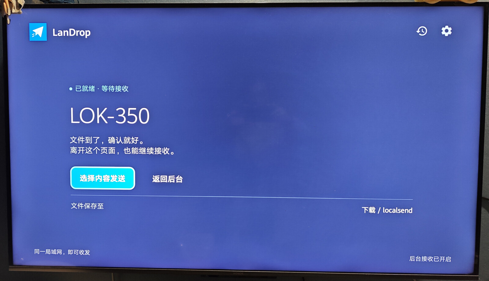
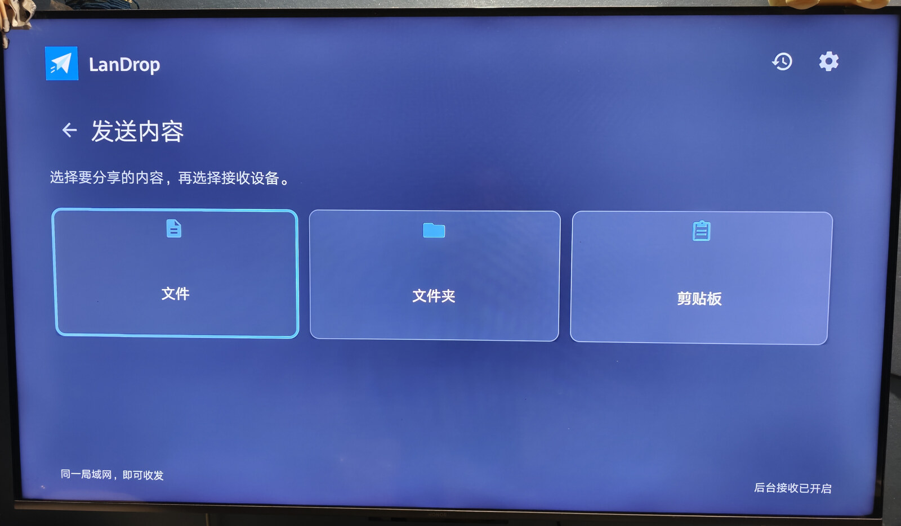
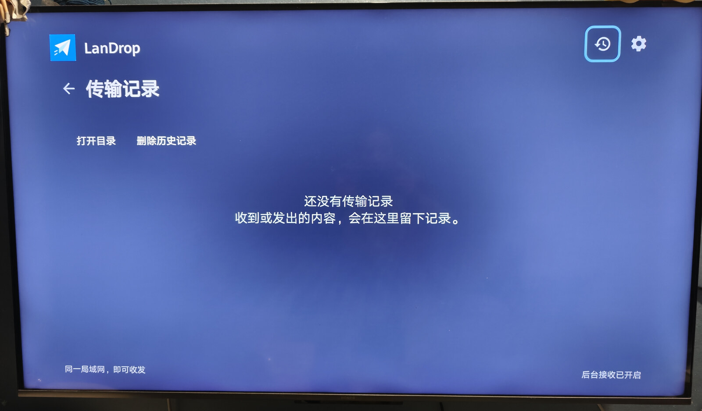
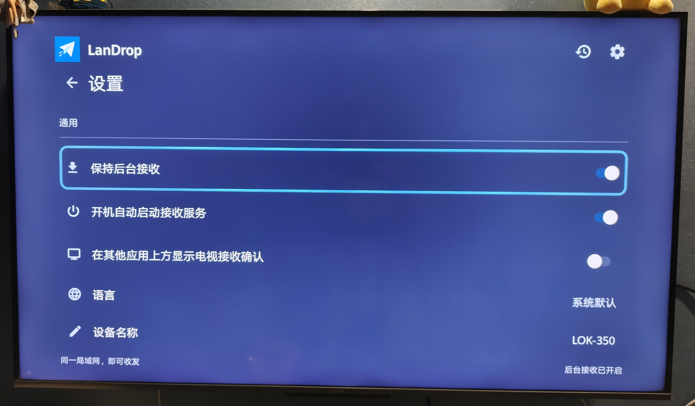

# LanDrop

[English](README.md) | [简体中文](docs/README.zh-CN.md)

LanDrop is a lightweight **Android TV** file-transfer app built with Kotlin and native Android Views. It uses the LocalSend protocol and is an unofficial, independent client.

The first LanDrop version is **1.0.0**. This source tree does not imply that a store release or interoperability certification has occurred.

## Why LanDrop

- **Minimal, with an APK under 5 MB.** Kotlin and native Android Views keep the app small. The current compiled debug APK is 3,996,260 bytes (about 4.0 MB), taking little space on a TV.
- **Built for the TV remote.** A landscape layout, large controls, and visible D-pad focus make it easy to navigate from the couch.
- **Works with the LocalSend ecosystem.** Phones and computers can keep their existing LocalSend client to exchange files, folders, and text with the TV, without installing another companion app.
- **Direct LAN transfers.** Discover nearby devices and transfer over the local network, without an account or a cloud relay.

## On a TV

These four photos were taken with a phone and show LanDrop running on a TV.

| Home | Send content |
| --- | --- |
|  |  |
| **Transfer history** | **Settings** |
|  |  |

## Use

- Open the app to see the device name, receiving status, and save location. Receiving runs in a foreground service; background receiving and start-on-boot are enabled by default.
- Accept or reject incoming files and text. Text is copied only on request; received links and APKs do not open automatically.
- To send, choose **Select content → File / Folder / Clipboard → Nearby device**. Discovery supplies the device list.
- View progress and review send/receive records. Clearing records does not delete files.
- Cancellation requires confirmation. **Stop all** beside the Transfer center title stops all current transfers; **Stop transfer** on a transfer affects only that transfer. Incoming files also have a **Stop file** action.
- Change the device name, language, save directory, background receiving, boot behavior, and TV overlay confirmation in Settings. The interface supports light/dark system themes and D-pad focus.

Files save to `Download/localsend/` by default. A system-authorized directory can be selected instead. Android 5.0 or later is required; the UI is designed for TV. Phones and computers running LocalSend are intended peers.

## Compatibility status

LanDrop advertises an **HTTP receiving endpoint**, LocalSend protocol `2.0`, and TCP/UDP port `53317`. Outgoing registration, transfer, and cancellation accept HTTP or HTTPS peers. HTTPS uses a persistent AndroidKeyStore client certificate and peer certificate fingerprint checks, matching LocalSend's mTLS identity contract. This does not encrypt inbound HTTP transfers or prove default-client interoperability on real devices.

Folder transfers preserve relative paths and reject traversal/absolute paths. Text retains explicit acceptance and copying. Pending-request cancellation and the confirmation timeout have been improved; checksum retry handling is implemented but still needs device acceptance, as do cancellation races and actual interoperability. See the [compatibility roadmap](docs/TV-TODO.md) and [design/compatibility review](docs/design-review.md).

Peers need a reachable LAN. Network isolation, multicast filtering, vendor background restrictions, force-stop, and standby can interrupt receiving. Browser-link receiving and resumable transfers are not implemented.

## Documentation

- [TV user guide](docs/android-receiver.md): receiving, sending, storage, permissions, and settings.
- [Development and validation](docs/development.md): container builds, tests, artifacts, and release preparation.
- [Compatibility roadmap](docs/TV-TODO.md): remaining work and acceptance criteria.
- [LocalSend protocol 2.2 reference](docs/LocalSend-Protocol-v2.2.md).
- [Release notes](CHANGELOG.md): LanDrop versions, starting with 1.0.0.
- The offline design preview lives in the sibling `landrop-ui-design/` directory; it uses simulated transfers.

## License

[Apache License 2.0](LICENSE). Third-party notices and upstream attribution are retained in [NOTICE](NOTICE).

Upstream contributions include [@FXDaily](https://github.com/FXDaily) for TLS fingerprint handling and an Android 5.1 receiving fix.
